  

  
  
  <!-- Add the ones you use. Copy the pattern and swap the name, link and logo -->
  <!--  -->
  <!--  -->
  <!--  -->

## ◆ About

Cloud Engineer, DevOps/SRE and AI engineer based in Kathmandu. I design secure, automated, cost-aware platforms across **AWS, Azure and GCP**, build **AI/ML and video-generation systems** that run in production, and turn what I learn into training, mentoring, technical writing and YouTube content.

> Priorities on every system: **security · reliability · scalability · performance · automation · maintainability · cost**.

<table>
  <tr>
    <td width="33%" valign="top">
      <h3>☁️ Cloud &amp; Platform</h3>
      Multi-cloud architecture on AWS, Azure and GCP. Infrastructure as Code, landing zones, IAM and security baselines, FinOps.
    </td>
    <td width="33%" valign="top">
      <h3>🔁 DevOps / SRE</h3>
      CI/CD, GitOps, Kubernetes, observability and SLI/SLO-driven reliability, with incident response and automation at the core.
    </td>
    <td width="33%" valign="top">
      <h3>🧠 AI Engineering &amp; Research</h3>
      LLM and ML systems with evaluation, deployment and MLOps. Models treated as production services, not notebooks.
    </td>
  </tr>
  <tr>
    <td width="33%" valign="top">
      <h3>🎬 AI Video &amp; Content</h3>
      Automated pipelines from prompt to script, scenes, voiceover, subtitles and render. Content for <b>Om Thakur Explain</b> and <b>Engineer Toons</b> on AI, global tech and semiconductors.
    </td>
    <td width="33%" valign="top">
      <h3>🎓 Training &amp; Mentoring</h3>
      Hands-on labs, workshops, learning paths and certification-focused programs for cloud and DevOps engineers.
    </td>
    <td width="33%" valign="top">
      <h3>🤝 Consulting &amp; Writing</h3>
      Architecture reviews, platform and cost optimization, plus clear technical writing and documentation.
    </td>
  </tr>
</table>

## ◆ Featured work

| Project | What it is | Stack |
| :-- | :-- | :-- |
| [**YT Motion Studio**](https://github.com/omthakurofficial/YT-Motion-Studio) | AI motion and video studio, my most active build | `AI` `Video` |
| [**OrderChha**](https://github.com/omthakurofficial/orderchha) | Ordering platform for food businesses | `TypeScript` |
| [**Thakur AgriTools Hub**](https://github.com/omthakurofficial/thakur-agritools-hub) | Digital tools platform for agriculture | `TypeScript` |
| [**TekBay Academy**](https://github.com/omthakurofficial/tekbay-academy) | Cloud Apprenticeship Program site | `TypeScript` |
| [**AWS Labs**](https://github.com/omthakurofficial/awsrestartgithub) | Hands-on AWS labs for training material | `Python` `AWS` |

Studying and building on open-source AI video generators: [YumCut](https://github.com/omthakurofficial/app.yumcut.com) and [short-video-generator-AI](https://github.com/omthakurofficial/short-video-generator-AI).

## ◆ Toolbox

<!-- Keep only what you actually use in production -->

**Cloud & Platform** 

**CI/CD & Observability** 

**Languages & Frameworks** 

**AI / ML** 

## ◆ Activity

  
  

  

  

## ◆ Work with me

**Cloud and DevOps consulting · corporate and individual training · mentoring · technical writing · AI and video automation**

Start at **[omthakur.info.np](https://omthakur.info.np)**.
